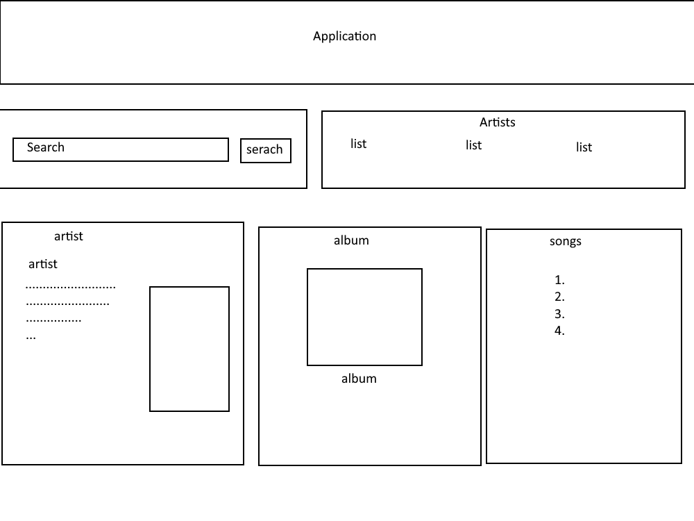

# Music App

**Author:** Katriina Chindjapin

## Project plan

### Project idea

An application where you can search for an artist and it will display their most popular album, songs on said album and some information about the artist. 

### Planned features

- Feature 1: Search for the artist / Select an artist from the list
- Feature 2: Displays picture of the artist
- Feature 3: Displays info about the artist
- Feature 4: Displays the most popular album
- Feature 5: Displays the songs on the most famous album

### Wireframe / sketch

## Web links

- **Published application:** [Link to GitHub Pages]()
- **GitHub-repository:** [Link to GitHub](https://github.com/katriinac/Project-2-Music-App)
- **Project video presentation:** [Link to the video]()

## About the application

**[Music App]** is a web application where you can search for an artists and the application will display the info about the artist, pictures and songs on the most famous album.

## Technologies

- HTML – page structure.
- CSS – styling and layout.
- JavaScript – functionality, DOM scripting, AJAX, JSON, API.

## How to use the application

1. Open the published application via the link above.
2. Search for an artist or select from a list.

## Running the application locally

1. Clone or download this repository to your computer.
2. Open the project folder.
3. Open `index.html` in a web browser.

## Screenshots

## Known issues / limitations

- Sometimes the images will not display (all the ones listed in the list have been checked and should include all the pictures), so you have to press search again. Sometimes it needs to be searched multiple times before it displays the images.
- Sometimes it will say Error: Could not fetch MusicBrainz data and display everything else (album and songs). This requires to search again.
- Sometimes the album and artist will display but the songs don't display, need to search again.
- If there is no bio or picture for the artist, it will only display the artists name.
- If you search for something that cannot be found, it will display previous artists album and songs
- The album and songs might get displayed before the artist info appears.
- The pictures load sometimes really slow.

## Self-assessment and learning reflection

- What did I succeed at? I got the application to work as intended and with all the requirements. After a lot of research, I managed to find a way to display the pictures. 

- What was challenging? Figuring out how to display the pictures, since the feature was not available anymore using only last.fm api. I also took a long time to figure out how to display all the information correctly, but managed in the end. I think this might have something to do why the application takes a long time to display the information or sometimes results in the errrors. 

- What would I improve if I had more time? I would try to fix all the known issues, since some of them I think might be a simple fix. I would maybe also add some other features on the website, since now you can just search for an artist. Also I would make the site more appealing, right now it looks too basic.

- What did I learn about AJAX, JSON and API? It's cool that you can use different apis to display information on your own webpage, but it seems a little bit complicated, especialle when the api returns a lot of different information.

- My self-assessed project grade: **7/10 points**

## Sources and acknowledgements

Since Last.fm permanently restricted image access through the public API, I had to find a way to display the pictures on the website. Some searching led me to [StackOverflow](https://stackoverflow.com/questions/55978243/last-fm-api-returns-same-white-star-image-for-all-artists)
post where I found out about MusicBrainz. I found this link to [a Javascript example](https://github.com/hugovk/now-playing-radiator/commit/e6de980db9da6846edc5aa2d2f7057b8f3b21bc8) in the comment section, that demonstarates how to use the mbid id provided by Last.fm to search for pictures using MusicBrainz. I tried using this example, with help of [MusicBrainz](https://musicbrainz.org/doc/MusicBrainz_API). I couldn't get this to work, so I turned for help of AI. I explained what I was trying to do and sent a piece of my code related to that. I used ChatGPT-5 for this. It helped me to build the working code, which I maked clearly by comments.
- [Last.fm Api quide](https://www.last.fm/api/intro) Helped me to use the right api methods.
- [Last.fm Api artist.search quide](https://www.last.fm/api/show/artist.search) Helped me to understand and use the api method for searching the artists.
- [Last.fm Api artist.getTopAlbums quide](https://www.last.fm/api/show/artist.getTopAlbums) Helped me to understand and use the api method for searching the top albums of the the artists.
- [Last.fm Api artist.getInfo quide](https://www.last.fm/api/show/artist.getInfo) Helped me to understand and use the api method for searching the artists information.
- [Last.fm Api album.getInfo quide](https://www.last.fm/api/show/album.getInfo) Helped me to understand and use the api method for searching the albums songs.
- I also used the Workshop7 and 8 assignments I had completed earlier to help with creating the code. (https://github.com/katriinac/web-development-1)

  ## License
